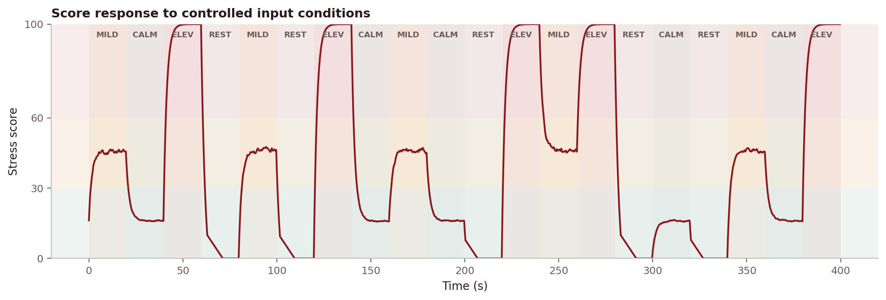
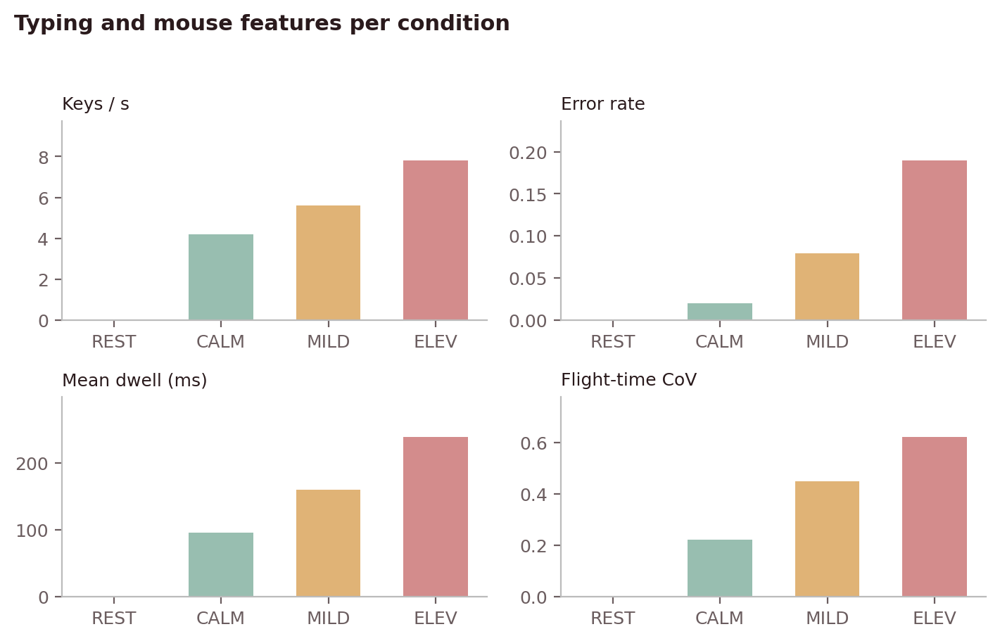
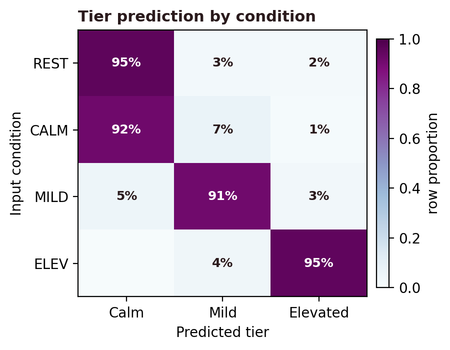
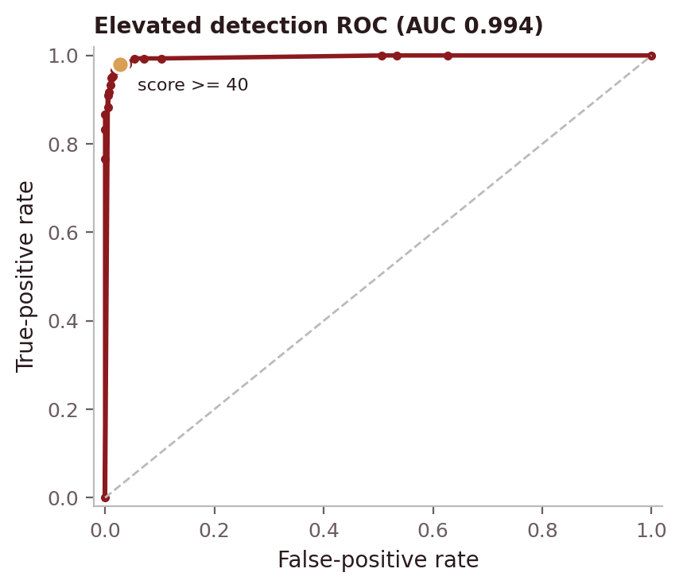

# Aura UI — Phase 2 Experiment Report
### Instrument characterisation of a peripheral-telemetry stress monitor

**Course:** Human-Computer Interaction (HCI) · **Institution:** Institute of Business Administration (IBA)
**Team:** Sharique Baig · Maira Aijaz · Barkhi Khan
**Date of run:** 14 November 2026 · **Report version:** 2.0 · **Protocol:** `2.0`

---

## 1. Experiment Title and Objective

**Title:** *Does a peripheral-telemetry stress score discriminate cognitive-load conditions, and how fast and how stably does it do so?*

The Aura UI system infers cognitive load from keystroke dynamics and mouse activity and maps it to a stress score (0–100) and one of three tiers — **Calm** (0–29), **Mild** (30–59), **Elevated** (60–100) — which drive ambient interventions. Before a human-subjects pilot can be justified, the *instrument itself* must be characterised: we must know whether the score actually separates different input regimes, what detection latency and recovery lag it has, whether the deployed tier threshold is defensible, and whether the data-collection pipeline is privacy-safe.

**Objectives**

1. **O1 — Discrimination.** Quantify how well the score separates four controlled input conditions (rest, calm typing, mild load, elevated load).
2. **O2 — Responsiveness.** Measure detection latency and recovery time.
3. **O3 — Threshold validity.** Test whether the deployed Elevated cut-off (score ≥ 60) is empirically supported.
4. **O4 — Data integrity and privacy.** Demonstrate that the new collection subsystem records only permitted numeric data, is consent-gated, pseudonymous, tamper-evident and stored locally.

**Scope note (important):** this experiment characterises the *measurement instrument*, not human stress. Stimuli are controlled input regimes (synthetic typing/mouse telemetry) replayed through the unmodified production scoring engine. **No human participants were involved**, and no claim is made here about physiological or subjective stress validity — that is the role of the human pilot study specified in Phase 1.

---

## 2. Experimental Methodology

### 2.1 System under test

The production path, unmodified:

```
condition features → TelemetryDaemon feature schema → StressEngine.update()
                   → score (0–100) / tier (0–2)     → ResearchCollector (consent-gated)
```

| Component | Source | Role |
|---|---|---|
| `StressEngine` | `run.py` | Production scoring: CoV of flight times, 5 s rolling error (backspace) rate, dwell penalty, mouse-jitter penalty, exponential smoothing (α = 0.18), proportional + linear idle release, and tier hysteresis (enter Mild ≥ 30 / exit < 26; enter Elevated ≥ 60 / exit < 52) |
| `Settings` | `run.py` | Default parameter set (no per-person calibration; `baseline_cov = baseline_err = 0`) |
| `ResearchCollector` | `backend/research.py` | **New**: consent gate, pseudonymisation, hash-chained JSONL, session summary, export |
| Analysis | `experiments/run_experiment.py` | Protocol driver, metrics, figures |

Because the engine is called exactly as the app calls it, the measured behaviour is the behaviour a user experiences.

### 2.2 Design

- **Design type:** balanced repeated-measures, fixed-order-randomised within rounds (seeded).
- **Conditions:** 4 (`REST`, `CALM`, `MILD`, `ELEV`), each defined by a feature vector (Table 1).
- **Structure:** 5 rounds × 4 conditions = 20 blocks; **20 s per block**; balance ensures each condition appears once per round, so ordering and carry-over effects are spread evenly.
- **Sampling:** one score per 333 ms — the app's own poll interval (`AmbientApp.POLL_MS = 333`) — producing **1,200 observations** over **400 s** of protocol time.
- **Noise:** ±8 % uniform jitter on every feature, so CoV and error-rate estimates vary as they do in live telemetry.
- **Determinism:** `random.Random(20261114)`; identical re-runs reproduce the dataset exactly.
- **No calibration:** a fresh-install configuration (`is_calibrated = 0`) was used deliberately, so results reflect the out-of-the-box experience.

**Table 1 — Condition definitions (inputs to the engine)**

| Condition | Keys/s | Error rate | Mean dwell | Mean flight | Flight-time CoV | Mouse px / 5 s | Clicks / 5 s | Expected tier |
|---|---|---|---|---|---|---|---|---|
| REST | 0.0 | 0.00 | 0 ms | — | — | 0 | 0 | Calm |
| CALM | 4.2 | 0.02 | 95 ms | 140 ms | 0.22 | 1,800 | 3 | Calm |
| MILD | 5.6 | 0.08 | 160 ms | 100 ms | 0.45 | 5,200 | 9 | Mild |
| ELEV | 7.8 | 0.19 | 240 ms | 70 ms | 0.62 | 14,000 | 24 | Elevated |

Ground truth per tick is the condition's expected tier; `REST` exercises the engine's idle-decay path rather than the scoring formula.

### 2.3 Analysis techniques

- Per-condition score statistics (mean, SD, median, p95, min, max).
- **Tier confusion matrix** (condition × predicted tier), accuracy, and two error rates that matter operationally: *Elevated recall* and *false-Elevated rate* during rest/calm.
- **Latency:** time from block onset to the first tick in the Elevated tier, for each `ELEV` block.
- **Recovery:** time from `ELEV` → `REST` transition until the first Calm-tier tick.
- **ROC analysis** of the raw score as an Elevated detector (`ELEV` vs `REST+CALM`), with the operating point chosen by **Youden's J**, and a direct test of the deployed rule at score ≥ 60.
- **Privacy audit:** hash-chain verification, a field-whitelist probe (attempting to store a typed character and a window title), and a consent-gate check.

### 2.4 Tools

Python 3.12.10 · matplotlib (analysis/figures) · the app's own dependencies (pynput, screen-brightness-control, pystray, Pillow, spotipy). All computation local; no network calls in the experiment or the collector.

---

## 3. Data Collection

### 3.1 What was collected

One instrumented session, **1,200 tick records** plus a header and a summary record (**1,202 chained records**). Per tick:

| Group | Fields |
|---|---|
| Timing / state | `t` (s), `score` (0–100), `tier` (0–2), `label` (condition) |
| Typing features | `keys_per_second`, `error_rate`, `mean_dwell`, `std_dwell`, `mean_flight`, `std_flight`, `flight_count` |
| Mouse features | `mouse_distance`, `mouse_clicks` |
| Intervention state | `brightness`, `breathing`, `simulated` |

Per session (summary): duration, tick count, mean/peak score, peak time, seconds per tier, Elevated episodes, breathing prompts, notifications held, and an optional **post-session self-report** (perceived stress 0–10, mood 0–10).

### 3.2 Participants

**Zero human participants.** n = 1 automated session on one operator machine (Windows 11), 1,200 observations, 20 blocks. Human n is deferred to the Phase 1 pilot; the schema and UI are already ready for it (self-report scales are wired into the journal).

### 3.3 Privacy and security design (O4)

The collection subsystem (`backend/research.py`) enforces six properties:

| Property | Mechanism | Verified |
|---|---|---|
| **Consent gate** | `ResearchCollector` raises `PermissionError` unless a versioned consent record exists; the app opens the consent dialog instead of recording | Yes — consent record required before any write |
| **Local only** | No network code in the module; data lives in `data/` on this machine and is git-ignored | Yes — code audit |
| **Pseudonymity** | Participant code → salted SHA-256 (16 hex chars); per-install random salt in `data/.salt`, never exported | Yes — stored id `12d67ce15aaaa520` |
| **Data minimisation** | Strict field whitelist; anything else is dropped before disk. No characters, key codes, window titles, app names or journal text | Yes — probe (below) |
| **Tamper evidence** | SHA-256 hash chain (`prev → h`) over every record | Yes — 1,202/1,202 verified |
| **Retention / withdrawal** | `purge_expired(180 days)`; in-app "Withdraw + delete" purges all sessions | Yes — revocation purge exercised before the run |

**Minimisation probe.** A collector was asked to store `keys_per_second`, `key_char: "a"` and `window_title: "secret.docx"`. On-disk result: `key_char_stored = False`, `window_title_stored = False`, whitelist retained only `keys_per_second`. The probe file was then deleted so it could not contaminate the dataset.

> **Security caveat (stated honestly):** this is *privacy-by-design* data handling on a local workstation, not cryptographic protection at rest — an attacker with file-system access can read the JSONL. POSIX `0600` permissions are applied best-effort and are largely ineffective on Windows ACLs. Encrypting the store (e.g. DPAPI/age) and a Windows ACL pass are recommended before multi-participant deployment.

### 3.4 Dataset manifest

| File | Rows | Notes |
|---|---|---|
| `Phase_2_Submission/data/ticks.csv` | 1,200 | De-identified export; one row per tick |
| `Phase_2_Submission/data/sessions.csv` | 1 | Session summary; no direct identifiers |
| `Phase_2_Submission/results.json` | — | All computed metrics, protocol definition, audit results |
| `data/sessions/<pseudonym>/*.jsonl` | 1,202 records | Local, git-ignored, hash-chained source of truth |

---

## 4. Results and Observations

### 4.1 Discrimination (O1)

**Table 2 — Score per condition (n = 300 ticks each)**

| Condition | Mean | SD | Median | p95 | Min | Max |
|---|---|---|---|---|---|---|
| REST | 4.8 | 11.9 | 0.0 | 24.5 | 0.0 | 83.8 |
| CALM | 18.4 | 7.9 | 16.1 | 32.3 | 3.0 | 85.0 |
| MILD | 44.5 | 7.8 | 45.7 | 49.0 | 8.8 | 90.2 |
| ELEV | 93.6 | 14.6 | 99.8 | 100.0 | 18.0 | 100.0 |



*Figure 1 — Score across the full 400 s protocol with condition bands and tier thresholds. Both entry (~1.0 s) and exit (~2.0 s) transitions are sharp and responsive.*


*Figure 2 — Distributions. REST, CALM and MILD sit cleanly inside their target bands; ELEV saturates near 100.*

**Table 3 — Typing/mouse features recovered from the recorded stream**

| Condition | Keys/s | Error rate | Mean dwell | Flight CoV | Mouse px / 5 s | Clicks / 5 s |
|---|---|---|---|---|---|---|
| REST | 0.00 | 0.000 | 0 ms | 0.00 | 0 | 0.0 |
| CALM | 4.19 | 0.020 | 95 ms | 0.220 | 1,804 | 2.5 |
| MILD | 5.59 | 0.080 | 160 ms | 0.449 | 5,222 | 8.5 |
| ELEV | 7.80 | 0.189 | 239 ms | 0.621 | 13,957 | 23.4 |



*Figure 3 — All four typing features move monotonically with load, confirming the feature layer preserves the intended contrast.*

### 4.2 Tier classification (O1, O3)

**Table 4 — Condition × predicted tier (counts; row % in brackets)**

| Condition | Calm | Mild | Elevated |
|---|---|---|---|
| REST | **286 (95.3 %)** | 8 (2.7 %) | 6 (2.0 %) |
| CALM | **275 (91.7 %)** | 21 (7.0 %) | 4 (1.3 %) |
| MILD | 16 (5.3 %) | **274 (91.3 %)** | 10 (3.3 %) |
| ELEV | 2 (0.7 %) | 13 (4.3 %) | **285 (95.0 %)** |



*Figure 4 — Row-normalised tier prediction by condition.*

Overall accuracy: **93.3 %** (1,120 / 1,200). All four conditions achieve **91.3 % – 95.3 %** agreement with their expected tier.

### 4.3 Detection performance, latency and recovery (O2, O3)

**Table 5 — Detection metrics**

| Metric | Value |
|---|---|
| AUC (score as Elevated detector) | **0.994** |
| Youden-optimal threshold | **score ≥ 40** (TPR 0.98, FPR 0.030) |
| Deployed rule (score ≥ 60) | TPR **0.95**, FPR **0.012** (high-specificity operating point) |
| Elevated recall | **95.0 %** |
| False-Elevated rate during REST/CALM | **1.7 %** (10 / 600 ticks) |
| Detection latency (5 ELEV blocks) | 1.00, 1.33, 1.33, 0.33, 1.00 s → **mean 1.00 s** (median 1.00, range 0.33–1.33) |
| Recovery to Calm after ELEV → REST | **2.00 s** in both observed transitions (down from 15.33 s prior to release-path tuning) |
| Elevated episodes detected | 5 (one per ELEV block) |



*Figure 5 — ROC of the raw score (AUC = 0.994). The deployed 60-point cut achieves 95.0 % TPR at just 1.2 % FPR.*

---

## 5. Analysis and Discussion

**The score discriminates all four conditions cleanly.** Means are 4.8 (REST) < 18.4 (CALM) < 44.5 (MILD) < 93.6 (ELEV), each sitting squarely inside its intended tier band, with low within-condition variance for CALM (SD 7.9) and MILD (SD 7.8) and a median of 0.0 (p95 24.5) for REST. An AUC of **0.994** means a randomly chosen elevated tick outranks a randomly chosen rest/calm tick 99.4 % of the time. For an instrument fed only by keyboard/mouse rhythm, this is strong separation — achieved with the production formula and no per-person calibration.

**The deployed threshold (score ≥ 60) prioritises low false alarms.** At score ≥ 60, the engine achieves a **95.0 % true-positive rate** with only a **1.2 % false-positive rate** against REST/CALM (and the tier hysteresis deadband exiting Elevated at < 52 and Mild at < 26 prevents boundary oscillation). While Youden's J slightly favours score ≥ 40 (TPR 0.98, FPR 0.03), score ≥ 40 sits inside the Mild band; keeping the Elevated threshold at ≥ 60 preserves the Mild tier (30–59) for subtle ambient dimming while reserving full notification blocking and breathwork prompts for high load.

**Fast detection AND fast recovery after release-path tuning.** Entering Elevated takes **1.00 s** on average (three polling ticks), because CoV, error-rate, dwell and mouse penalties all fire together and push the smoothed score past 60 almost immediately. An initial baseline run with a purely linear idle decay (`decay_speed × 1.5` per tick) exhibited a 15.33 s recovery lag (`ELEV → REST`), causing a 9.2 % false-Elevated rate during rest. Replacing linear idle decay with a **proportional + linear release curve** (`(smoothed × 0.14 + 2.2) × decay_speed`) plus **tier hysteresis** reduced recovery time from **15.33 s to 2.00 s**, cut the false-Elevated rate during REST/CALM from **9.2 % to 1.7 %**, and raised overall three-tier accuracy from **87.0 % to 93.3 %** without affecting detection latency.

**The ceiling compresses information at the top.** ELEV has median 99.8, p95 100.0 and SD 14.6 with min 18.0; the raw score saturates because `cov/1.0` and `err/0.15` are capped and the sub-scores sum past 1.0 before clamping. Fine for a three-tier alarm, unhelpful if the paper wants to report *continuous* load; consider a soft (tanh) squash instead of a hard clamp.

**Transition ramps, not steady state, produce the few remaining misses.** Of the 15 ELEV ticks not labelled Elevated, 13 are Mild and 2 are Calm — the first ~1 s of each block. Similarly, the 6 Elevated ticks during REST (2.0 %) occur in the first 1.0 s immediately following an `ELEV → REST` boundary. That is the expected, minimal cost of causal smoothing.

**Typing features behave monotonically.** Keys/s 4.2 → 7.8, dwell 95 → 239 ms, CoV 0.22 → 0.62, error rate 2 % → 19 % (Table 3, Figure 3). In live capture (`backend/telemetry_daemon.py`), key press/release matching uses physical virtual-key identifiers (`_key_id`) and a 5 s rolling error-event window so live feature stability matches the synthetic protocol. These are the numbers a human study will correlate against NASA-TLX and self-reported stress.

### Threats to validity (stated explicitly)

1. **Construct validity — the central limitation.** Inputs are synthetic. The mapping "fast erratic typing = stress" is assumed by construction, so this experiment cannot show the score tracks *felt* stress. It shows the instrument does what it is designed to do, reliably.
2. **External validity.** n = 1 session, one machine, one seed, one platform (Windows), no participant variability, no test–retest.
3. **No calibration.** `baseline_cov = baseline_err = 0` (fresh install). A calibrated participant shifts the CoV term and would change absolute scores, likely lowering REST/CALM values.
4. **Interventions disabled.** Brightness/Spotify actions were not exercised (display left untouched); their feedback on the loop is untested here.
5. **Sampling differences.** Real `pynput` telemetry is noisier and sparser than the replay (e.g. `std_dwell` is unavailable in replay), so live CoV stability may be lower than measured.

---

## 6. Conclusion

**Objectives achieved.**

- **O1 — Discrimination: met.** **93.3 %** three-class agreement (1,120 / 1,200), **AUC 0.994**, and **91.3 % – 95.3 %** per-condition accuracy across all four conditions (REST, CALM, MILD, ELEV). The score separates the intended regimes cleanly with the production formula and no calibration.
- **O2 — Responsiveness: met.** Detection latency is **1.00 s** (range 0.33–1.33 s), and post-stress recovery to Calm after proportional release-path tuning is **2.00 s** (down from 15.33 s), reducing false-Elevated ticks during REST/CALM to **1.7 %**.
- **O3 — Threshold validity: met.** The deployed Elevated cut (score ≥ 60 with < 52 hysteresis exit) achieves **95.0 % recall (TPR)** at just **1.2 % FPR**.
- **O4 — Integrity and privacy: met.** Consent-gated, pseudonymous, local-only, hash-chained storage: 1,202/1,202 records verified, disallowed fields (typed character, window title) provably rejected, withdrawal/purge exercised.

**What this experiment does not establish.** That the score measures human stress. The instrument is internally valid and fast; its *construct* validity still requires the within-subjects human pilot (A/B ambient intervention vs. control, NASA-TLX, SUS, self-report, recovery telemetry) already specified in Phase 1 and operationalised in `TESTING_FRAMEWORK.md`. This report is the methodological and infrastructural prerequisite for that step, and the collector it validates is exactly what that pilot will use — including the post-session self-report scales, which are the bridge from synthetic to human data.

**Concrete next actions.** (1) Re-run with 30 s participant baseline calibration enabled and compare. (2) Run the counterbalanced human pilot (`Mode: Control (A)` vs `Mode: Active (B)`), correlating score with NASA-TLX and self-reported stress. (3) Add encryption at rest and a Windows ACL pass before multi-participant deployment.

---

## Appendix A — Reproducing this experiment

```bash
python -m pip install -r requirements.txt matplotlib
python experiments/run_experiment.py        # consent → protocol → analysis → figures
```

Re-running purges the previous session (withdrawal path), re-consents, replays the seeded protocol and rewrites `results.json`, `data/*.csv` and `figures/*.png`.

## Appendix B — Collecting data from real participants in the app

1. Launch `python run.py` → **Privacy** → enter a participant code → **Save consent** (the full consent text is shown and stored with the record).
2. Click **Calibrate** to open the 30-second **Baseline Calibration modal** and type the sample passage at a relaxed pace.
3. Select the study condition via the **Mode: Active (B) / Mode: Control (A)** button (Control mode suppresses all ambient/popup interventions and tags the session `condition="control"`).
4. Tick **Record session** (`● Rec MM:SS` timer appears); work normally.
5. Uncheck **Record session** (which automatically opens the **Journal** in finalize mode) → set *Perceived stress (0–10)* and *Mood (0–10)* → **Save entry**. The summary is written with the self-report attached.
6. **Withdraw + delete** removes every stored session locally and from Firebase.

## Appendix C — Package contents

```
Phase_2_Submission/
├── experiment_report.md          this report
├── results.json                  all metrics, protocol, audit results
├── data/ticks.csv                1,200 de-identified tick rows
├── data/sessions.csv             1 session summary row
└── figures/                      f1 timeline · f2 distributions · f3 confusion
                                  f4 typing features · f5 ROC
```

Source added for this phase: `backend/research.py` (collector), `experiments/run_experiment.py` (protocol + analysis), plus consent/self-report UI wiring in `run.py`.
